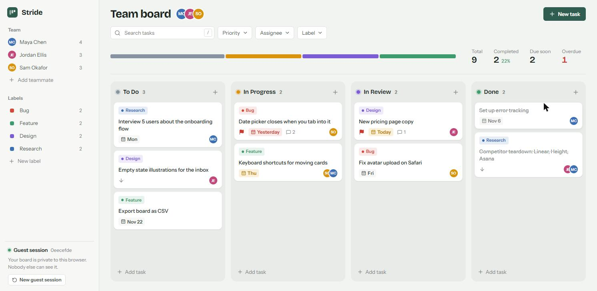

# Stride

A kanban board for small teams. Drag cards between columns, assign teammates, tag things with labels, leave comments, and see the full history of every task.

Built with React + TypeScript (Vite), Supabase (Postgres, anonymous auth, RLS, realtime) and dnd-kit. Hosted on Vercel.

**Live demo:** https://stride-board.vercel.app



## Features

- **Board**: To Do, In Progress, In Review, Done. Drag cards within and between columns (mouse, touch, or keyboard). Order is saved.
- **Guest accounts**: the first visit creates an anonymous Supabase user. No sign up. Every row is locked to that user with RLS.
- **Tasks**: title, description, priority, due date, assignees, labels. Quick add from any column, or the full form with `N`.
- **Team members**: add teammates (name + color), assign one or more per task, avatars on cards.
- **Labels**: custom labels with colors, multiple per task, filter the board by label.
- **Comments**: per-task thread in the side panel, stored in a separate `comments` table.
- **Activity log**: status moves, edits, assignments and label changes, written by Postgres triggers.
- **Due dates**: overdue / today / soon badges on cards.
- **Search + filters**: search by title (`/`), filter by priority, assignee and label.
- **Stats**: the bar under the header shows how work is spread across columns, with total / completed / due soon / overdue counts. Click Overdue to filter.
- **Realtime**: open the board in two tabs and moves show up in both.
- Loading skeletons, empty states, error toasts with retry, optimistic updates with rollback, responsive down to phone size.

## Running locally

You need Node 20+ and a Supabase project (the free tier is fine).

1. **Database.** In the Supabase SQL editor, run [`supabase/migrations/20261111000000_init.sql`](supabase/migrations/20261111000000_init.sql). Or with the CLI: `supabase link` then `supabase db push`.
2. **Anonymous sign-ins.** Supabase dashboard > Authentication > Sign In / Providers > turn on **Allow anonymous sign-ins** and save.
3. **Env vars.**
   ```bash
   cp .env.example .env.local
   ```
   Fill in `VITE_SUPABASE_URL` and `VITE_SUPABASE_ANON_KEY` from Project Settings > API. Use the anon/publishable key. Never the service role key.
4. **Run it.**
   ```bash
   npm install
   npm run dev
   ```
   Open http://localhost:5173.

`npm run build` type-checks and builds to `dist/`.

## Project layout

```
src/
  App.tsx                 auth gate + page layout
  hooks/
    useGuestSession.ts    creates / restores the anonymous user
    useFilters.ts         search + filter state and matching
    useTaskThread.ts      comments + activity for the open task
  state/
    BoardContext.tsx      all board data, optimistic mutations, realtime
    Toasts.tsx            toast notifications
    sampleBoard.ts        "load sample board" seed data
  components/             Board, Column, TaskCard, TaskPanel, ...
  lib/                    supabase client, types, date + ordering helpers
  styles/                 tokens.css (design tokens) + component styles
supabase/migrations/      the full schema, RLS policies and triggers
```

## Notes on a few decisions

- **Ordering** uses a float `position` per card. Dropping between two cards takes the midpoint, so a move is always a single-row update. There's a rebalance fallback for when the gap gets too small.
- **Activity log** is written by `security definer` triggers. Clients only have a `select` policy on `task_activity`, so they can read their history but can't write fake entries.
- **Join tables** (`task_assignees`, `task_labels`) check that you own *both* sides of the link in the insert policy, not just the row itself.
